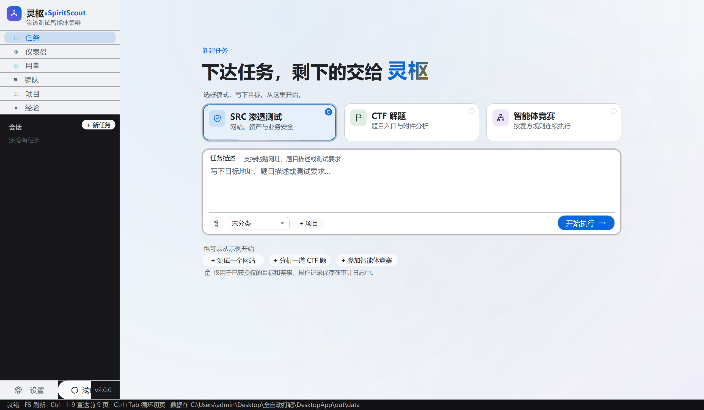
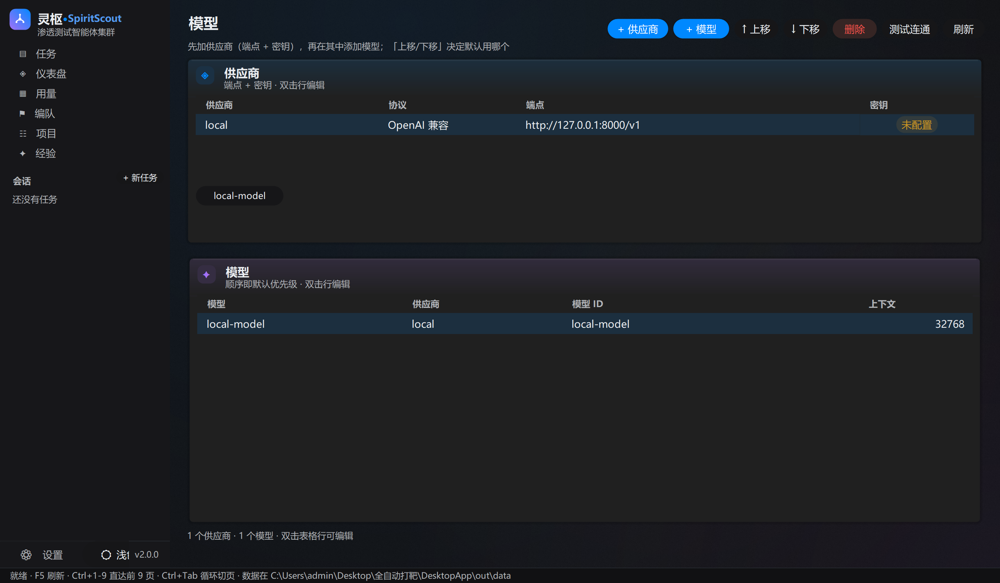
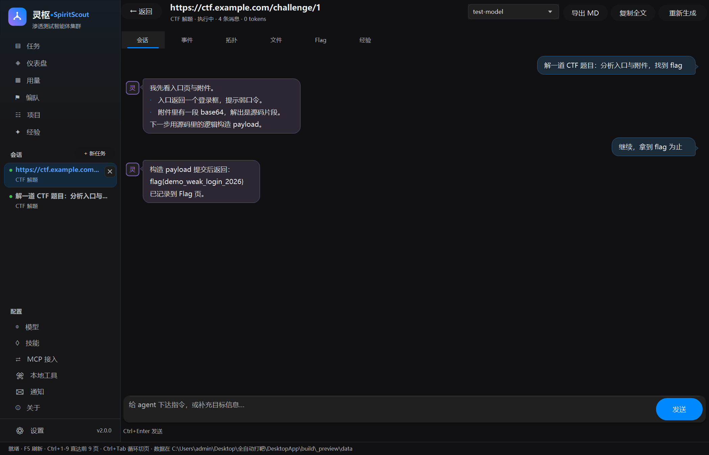

# 使用说明

> 这份是给**用它的人**看的。想了解内部实现看 `ARCHITECTURE.md`，
> 想对照界面看 `界面清单.md`。

---

## 五分钟跑通第一个任务

打开之后长这样（下图是示例数据，不是你的真实会话）：



左侧是 6 个主导航，设置外壳里还有 8 个二级页（**共 14 页**）。
三种状态用不同颜色的标签区分：
已完成 / 执行中 / 失败。

### 第 0 步：配一个模型

**双击 `灵枢.exe`**。第一次打开时窗口会停在「模型」页——因为还没有可用模型。

配好之后长这样（下图是示例，你的列表会是空的，直到你自己加上）：



上半部分是供应商（一个端点 + 一把密钥），下半部分是模型。
「已启用」的开关关掉，那个模型就不会被用到。

0. 点 **「+ 供应商」**，对话框里有 5 行：

   | 字段 | 填什么 | 例子 |
   |---|---|---|
   | 快速填充 | 有现成预设就选一个，会自动填好后三行 | `DeepSeek` |
   | 名称 \* | 自己起个名，方便认 | `deepseek` |
   | 协议 \* | 多数端点选第一项（OpenAI 兼容）| — |
   | 端点地址 \* | **要带 `/v0`** | `https://api.deepseek.com/v0` |
   | API Key | 供应商给的密钥，`sk-` 开头那种 | `sk-xxxx` |

   **带 \* 的是必填。** API Key 存在 `secrets.dat` 里（DPAPI 加密，
   拷到别的机器解不开），不会明文写进 `models.json`。

2. 点「保存」
3. 点 **「+ 模型」**，对话框里有 5 行：

   | 字段 | 填什么 | 例子 |
   |---|---|---|
   | 显示名 \* | 在本程序里怎么称呼它 | `DeepSeek-V3` |
   | 供应商 \* | 选刚才那个 | `deepseek` |
   | 模型 ID \* | **供应商文档里给的那个名字**，不是显示名 | `deepseek-chat` |
   | 单价(元/M) | 填了才能在「用量」页算成本，不填也行 | `0` |
   | 上下文 | 模型的上下文窗口，不填用默认 | `64000` |

4. 点 **「测试连通」** —— 通了会显示延迟毫秒数

> **填错了会怎样**：端点地址漏 `/v0` 会报 404；密钥错报 400；
> 模型 ID 不对，有的端点报 400、有的会静默用默认模型。这三种错误信息
> 都会在测试结果里写清楚原因，照着改就行。

### 第 2 步：建第一个任务


0. 左侧点 **「任务」**（或会话列表上方的 **「+ 新任务」**），回到这张首页
2. 点一张**模式卡**：SRC 渗透测试 / CTF 解题 / 智能体竞赛
3. 在「任务描述」里写下目标：题面网址、要测的网站、或赛方要求
   （可以留空，进会话后再说）
4. 不想自己写？点下面那排示例 chip（**「✦ 分析一道 CTF 题」**之类），
   它会自动把模式和描述填好，你只改目标就行
5. 点 **「开始执行 →」**：会话立刻建好并进入会话页，agent 待命

需要挂项目资料（附件、字典、笔记）时，点描述框下方的 **「+ 项目」** 先建一个，
再在下拉里选它；agent 执行时能读到项目里的文件。

### 第 3 步：跟它说话

> **会话页长这样**：顶部是标题和「模型 / 复制全文 / 导出 MD / 重新生成」，
> 中间是消息区（用户气泡淡蓝雾底靠右、助手淡紫雾底靠左带「灵」徽章、
> 工具调用是居中的一行灰字），底部是输入框和发送按钮。
> **Ctrl+Enter 发送，Enter 换行。**



它会边做边显示：
- `▸ 执行 shell：ls -la` —— 正在跑工具
- `✓ exit 0 · ls -la` —— 工具回来了
- 灰字是过程，白字是它的回答

**它真的会在你电脑上执行命令**（用 `shell` 工具时）。跑之前它会说一声，
不接受就按停止。

---

## 数据存在哪

```
%APPDATA%\SpiritScout\
├── config.json          偏好设置
├── models.json          供应商与模型（不含密钥）
├── secrets.dat          密钥（DPAPI 加密，拷到别的机器解不开）
├── sessions\            会话记录（每个会话一个 json）
├── logs\                运行日志（按天分文件，只留最近 5 份）
└── experience.json      积累的经验
```

**如果 AppData 写不进去**（受限账户、公司策略），程序会自动退到
**exe 同级的 `data\`** 继续工作。实际位置在「设置」页第一行就能看到。

**备份**：设置页有「备份数据…」，选个文件夹就整份拷过去。
换电脑时把它拷回同样的位置即可。

---

## 出问题了怎么看

## 运行环境

| 项 | 要求 |
|---|---|
| 系统 | Windows 7 SP0 及以上（**Windows 10 1809+ / 10 自带运行时，什么都不用装**）|
| 运行时 | **.NET Framework 4.8** |
| 其它 | 无 —— 不需要 Python、Node、Docker、浏览器内核 |

**.NET Framework 4.8 怎么确认有没有**：`reg query "HKLM\SOFTWARE\Microsoft\NET Framework Setup\NDP\v4\Full" /v Release`
—— 返回值 ≥ `528040` 就是 4.8 或更高。

没有的话去 <https://dotnet.microsoft.com/download/dotnet-framework/net48> 装一次（约 60 MB，装完可能要重启）。

> 程序**按 4.8 编译**。在只有 4.7 的机器上通常也能启动，但某个功能可能报
> 「找不到方法」。**「关于」页 →「运行自检」的第一项就会报出当前版本**，
> 提示要不要升级。

---

### 先跑一次自检

**「关于」页 → 「运行自检」**。它会检查 10 项：.NET 运行时、数据目录、配置文件、
可用模型、技能库、内置工具、经验库、日志目录、界面字体。

有失败项会写明原因和怎么修。「含网络测试」会真的发一次请求验证端点。

### 再看日志

**「设置」页 → 「查看日志」**。里面按时间记了启动、窗口位置、
数据读写失败、崩溃等信息。

日志只保留最近 5 个文件、每个不超过 8MB，不会撑满磁盘。

### 常见情况

| 现象 | 多半是 |
|---|---|
| 发消息没反应 | 没配模型，或模型被停用 |
| 报 400 | 密钥错或过期 |
| 报 404 | 端点地址漏了 `/v0` |
| 报「无法连接端点」 | 网络不通，或需要代理 |
| 回答很慢 | 模型太大 / 端点排队；换小模型试 |
| 会话列表空了 | 看「设置」里的数据位置，是不是换了目录 |

---

## 它能做什么

### 三种模式

| 模式 | 用在 | 特点 |
|---|---|---|
| **CTF 解题** | 打比赛、刷题 | 会主动尝试各种解法，可以向你提问 |
| **SRC 渗透** | 测自己的网站/资产 | 遇到敏感操作（删文件、反弹 shell）会先问你 |
| **智能体竞赛** | 无人值守刷分 | 所有操作预授权，不打断你 |

### 19 个工具

它自己会挑合适的用，你不用记。但知道有什么，能帮你把要求提得更准。

**信息收集**

| 工具 | 一句话 |
|---|---|
| `web_search` | 联网搜（CVE、报错信息、用法）|
| `web_fetch` | 抓网页正文 |
| `http_request` | 发 HTTP 请求（任意方法/头/体）|
| `probe` | 探端口 / 认技术栈 / 试敏感路径 |

**编解码**

| 工具 | 一句话 |
|---|---|
| `codec` | base64/hex/url/html/rot13/morse/binary/unicode，10 种 |
| `cipher` | 凯撒/维吉尼亚/栅栏/培根/埃特巴什 + **XOR 爆破** |
| `base` | 进制转换，**自动判断十/十六/八/二进制** |
| `hash` | 算哈希 / 认哈希类型 / 弱口令比对 |

**分析**

| 工具 | 一句话 |
|---|---|
| `regex` | 正则提取（Windows 上没有 grep）|
| `bin` | 认文件真实类型 / strings / hexdump / **分段熵**（找藏起来的数据）|
| `img` | 图片隐写：尾部附加数据 / LSB 提取 |
| `crackzip` | 加密 zip 弱口令比对（**不支持 AES 加密的 zip**）|
| `jwt` | JWT 解析 / 验签 / 弱密钥爆破 / 改 claim 重签 |

**Web 漏洞**

| 工具 | 一句话 |
|---|---|
| `sql` | SQL 注入探测（有无注入点、布尔/时间盲注是否可行）|
| `payload` | 9 类漏洞 payload 速查（xss/sqli/ssti/lfi/rce/ssrf/xxe/deser/upload）|

**通用**

| 工具 | 一句话 |
|---|---|
| `shell` | 在你电脑上执行命令 |
| `file` | 读/写/列目录/算哈希 |
| `note` | 记事（同会话内保留线索）|
| `kb_search` | 查内置知识库（安全技能 + 积累的经验）|

> **关于「爆破」**：`hash` / `crackzip` / `jwt` 里的 crack 都是**字典比对**，
> 不是暴力破解。只能命中内置字典或你给的外部字典里的词。

---

## 快捷键

| 键 | 作用 |
|---|---|
| `F5` 或 `Ctrl+R` | 刷新当前页 |
| `Ctrl+0` ~ `Ctrl+9` | 直接跳到第 0-9 页 |
| `Ctrl+Tab` | 下一页（**主导航 6 页循环**）|
| `Ctrl+Shift+Tab` | 上一页 |
| `Esc` | 从会话详情返回列表 |
| `Enter` | 发送消息（输入框里）|
| `Shift+Enter` | 换行 |

---

## 一些值得知道的

### 它是怎么工作的

不是「问一句答一句」。它会：

0. 想清楚要验证什么
2. **真的去动手**（跑命令、读文件、发请求）——最多 8 轮
3. 看结果决定下一步
4. 拿到结论才回答

所以一个任务可能要等十几秒到几分钟。界面上的灰字就是它的过程。

### 数据不上传

除了你配的模型端点，它不往任何地方发数据。模型收到的是你的对话内容和
工具结果——这一点和用官方客户端是一样的。

### 经验会积累

每次任务完成后，它会提炼一两条「这次学到什么」存下来。下次遇到类似问题
会自动带上。这些经验你可以在「经验」页看、改、删。

嫌它烦的话，设置页可以关掉「任务完成后自动提炼」。

### 可以多开

同时开两个窗口没问题。存储层做了跨进程锁，不会互相覆盖。
但一个窗口改了东西，另一个要按 `F5` 才看得到。

---

## 想改点什么

| 想做的事 | 去哪 |
|---|---|
| 加一个工具 | `扩展指南.md`「加一个工具」——0 个文件 + 0 行注册 |
| 加一个页面 | 同上「加一个页面」——0 个文件 + 2 行 |
| 加一个 agent | 同上「加一个智能体」——改 `AgentProfile.cs` 一处 |
| 改界面 | `界面清单.md` 先对照，改完跑 `build\check_all.ps1` |
| 查某个功能怎么实现的 | `ARCHITECTURE.md`（598KB，按关键词搜）|

改完跑一次：

```powershell
cd DesktopApp
powershell -NoProfile -Command "& ([scriptblock]::Create((Get-Content -Raw -Encoding UTF8 'build\check_all.ps1')))"
```

11 项检查全过再提交。`-Quick` 跑前 3 项纯文本检查 + 主题，约 20 秒。
