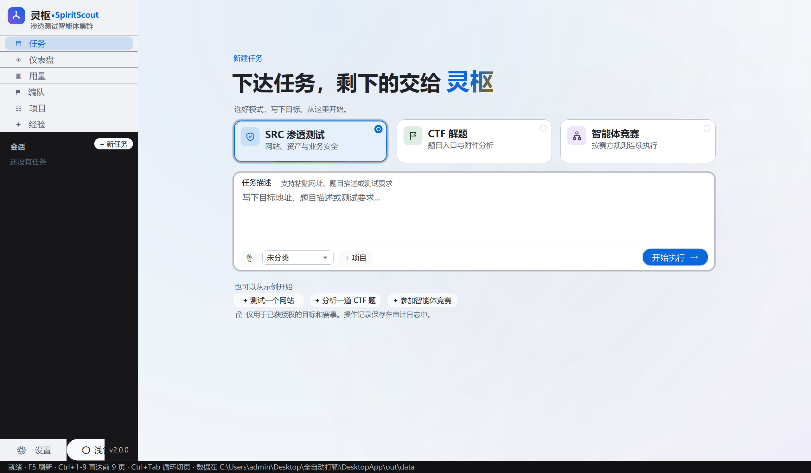
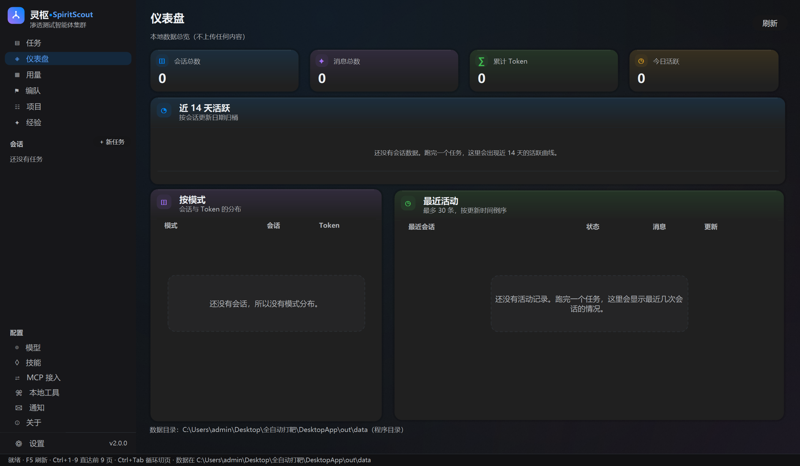
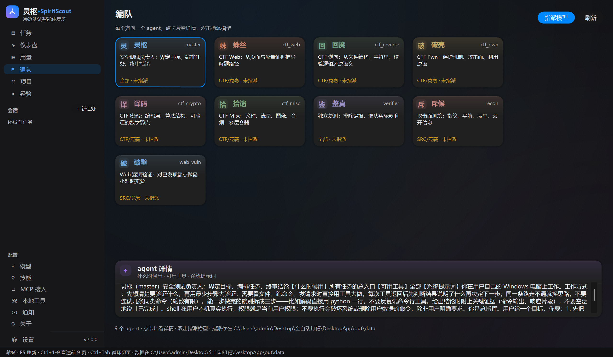
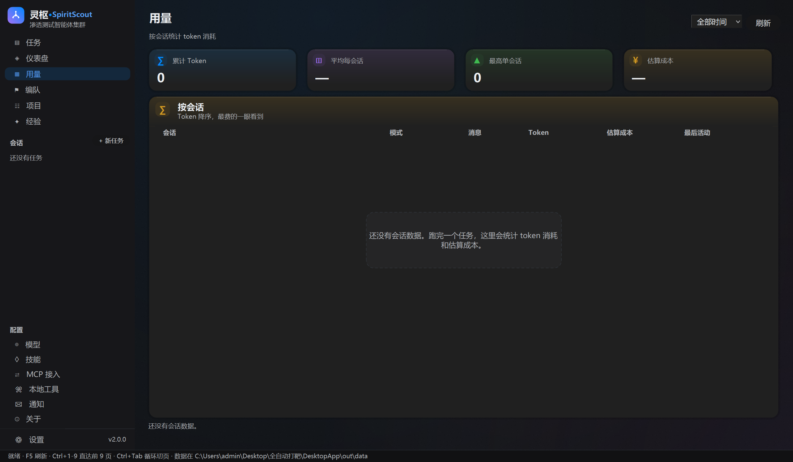
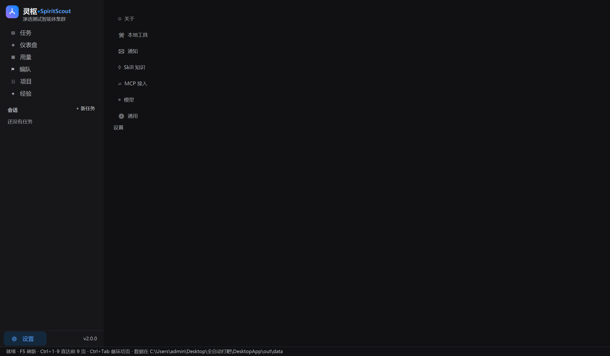

# 灵枢桌面版 · 2.0.0

> **这份说的是「这版有什么」。** 怎么配模型、怎么建任务，看 `使用说明.md`。

---

## 一句话

一个跑在你自己 Windows 电脑上的安全测试助手。单文件 exe，不需要 Python、
不需要 Node、不需要 Docker、不需要 WebView。双击就能用。

它会**真的动手**：读文件、跑命令、发 HTTP 请求、分析图片和压缩包——
最多自己走 8 轮工具调用，拿到结论才回答。

---

## 这版的规模

| 项 | 数量 |
|---|---|
| 单文件 exe | **1963 KB** |
| 页面 | **13** |
| 内置工具 | **19** |
| 智能体 | **9**（1 个主控 + 8 个专项）|
| 源码 | 92 个文件 · 24585 行 |
| 自动检查 | **11 项**，覆盖静态一致性、整机链路、界面布局、排版贴合、深浅主题、真机会话 |

---

## 界面

深色主题，14 个页面，统一「软面」视觉语言：无边框圆角软卡 + 顶部分类色晕 +
柔和投影，表格去网格线改斑马纹，原生滚动条/下拉/开关全部压成深色。
下面几张是实际渲染的截图（示例数据）。

**首页** —— 下达任务入口：氛围光背景 + 渐变大标题 + 三张按模式着色的模式卡 +
无缝任务描述输入卡：



**仪表盘** —— 四张色晕指标软块 + 近 14 天趋势折线 + 按模式/最近活动两个分区块：



**会话详情** —— 消息气泡按角色区分（用户蓝、助手灰、工具带工具名）：

> （会话详情页需要真实对话才能截图，见下面各页的配图）

**编队** —— 9 个智能体各一张色晕软卡：首字头像 + 代号 + 职责 + 指派模型，
选中卡描边强调，下方分区块看完整提示词：



**用量** —— 指标软块 + 「按会话」分区块，Token 降序、带成本估算：



**设置** —— 数据位置 / 运行日志 / 运行偏好三个分区块，开关为深色胶囊：



### 界面侧量化的东西

「好不好看」是主观的，但能客观量的都量了：

| 维度 | 结果 |
|---|---|
| 对比度（WCAG）| 正文 **16.02**（AAA）/ 说明文字 6.15（AA）/ 分隔线 2.02 |
| 页面饱满度 | 表格式页面背景占比 16-22%（不是「大片空白」）|
| 按钮高度档位 | 5 种（28/32/34/36/56，每档有语义）|
| 文字被裁 | 302 个控件，**0 处** |
| 内容溢出 | **0 页** |
| 图标重复 | 14 个页面符号，**0 重复** |

## 19 个工具

模型自己挑合适的用，你不用记。列出来是为了你提要求时更准。

**信息收集（4）**

| 工具 | 做什么 |
|---|---|
| `web_search` | 联网搜：CVE、报错信息、工具用法 |
| `web_fetch` | 抓网页正文（去标签、去脚本）|
| `http_request` | 发任意 HTTP 请求：方法/头/体 |
| `probe` | 探端口、认技术栈、试敏感路径 |

**编解码（4）**

| 工具 | 做什么 | 说明 |
|---|---|---|
| `codec` | base64 / hex / url / html / rot13 / morse / binary / unicode / reverse | 10 种，`auto` 动作会逐个试并只列出「解出可读内容」的 |
| `cipher` | 凯撒 / 维吉尼亚 / 栅栏 / 培根 / 埃特巴什 / XOR | **不给参数就自动爆破**，按英文频率排序 |
| `base` | 进制转换 | **自动判断十/十六/八/二进制**，`72 101 108` → `Hel` |
| `hash` | MD5 / SHA1 / SHA256 / SHA384 / SHA512 / CRC32 / NTLM | 认哈希类型、算值、弱口令字典比对 |

**分析（5）**

| 工具 | 做什么 |
|---|---|
| `regex` | 正则提取（**Windows 上没有 grep**，这是替代品）|
| `bin` | 认文件真实类型（不看扩展名，30+ 格式）、strings、hexdump、**分段熵**（定位藏起来的压缩/加密数据）|
| `img` | 图片隐写：尾部附加数据检测/导出、LSB 提取、文件内 strings |
| `crackzip` | 加密 zip 的密码字典比对（**自己实现 ZipCrypto，不依赖 fcrackzip**）|
| `jwt` | JWT 解析 / 验签 / 弱密钥爆破 / **改 claim 重签**（越权测试）|

**Web 漏洞（2）**

| 工具 | 做什么 |
|---|---|
| `sql` | 注入探测：找响应差异、判断布尔盲注是否可分、量时间盲注延迟 |
| `payload` | 9 类 payload 速查（xss / sqli / ssti / lfi / rce / ssrf / xxe / deser / upload）|

**通用（4）**

| 工具 | 做什么 |
|---|---|
| `shell` | 在你的电脑上执行命令 |
| `file` | 读 / 写 / 列目录 / 算哈希 |
| `note` | 记事（同会话内保留线索）|
| `kb_search` | 查内置知识库（1365 KB 安全技能 + 自己积累的经验）|

> **关于「爆破」**：`hash` / `crackzip` / `jwt` 里的 crack 都是**字典比对**，
> 不是暴力破解。只能命中内置字典（几十到几百条常见值）或你给的外部字典。
> 这一点在工具描述里也写明了，免得模型误以为能还原任意密钥。

---

## 相对早期版本，这一版新增

### 工具从 7 个加到 19 个

早期只有 `shell` / `http_request` / `web_fetch` / `file` / `note` / `kb_search`
这类通用工具，做题时得靠 `shell` 拼外部命令——而 Windows 上 `grep`、`strings`、
`file`、`fcrackzip`、`nmap` 一概没有。

现在这 12 个分析工具全是**原生 C# 实现**，不依赖装了什么东西。

### 14 个页面

任务 / 仪表盘 / 用量 / 编队 / 模型 / 项目 / 经验 / 技能 / MCP 接入 /
本地工具 / 通知 / 设置 / 关于。

功能面与 web 版逐区块对照过（自动检查 `web_parity`）：
web 的 12 个功能区块桌面全部有对应页面，差异只在层级——
web 把 MCP/技能/本地工具等收在设置二级，桌面提到侧栏一级，**少一次点击**。

### 高分屏自适应（DPI）

系统缩放 125% / 150% / 200% 下界面按比例整体放大，不再出现
「字小图糊、布局错位、侧栏被压扁」：

- 字体、间距、自绘内容统一走缩放层，150% 屏实测与客户区像素一一对应；
- 窗口位置/尺寸按设计坐标存储，跨不同缩放比显示器恢复不乱；
- 首页标题按可用宽度自动切换一行 / 两行排版（一行时蓝色→金色渐变，对齐 web 端）。

### 全局字号放大两个字号 + 排版适配

界面文字整体加大两个字号（150% 屏实测正文 24px），并且把放大后可能坏的地方逐处适配。

- **一个常量控制全站字号**：所有字体都从 `Theme.F(pt)` 出去，那里加
  `Theme.FontBump`。要调大调小改这一个数，不用逐页翻。
- 新增 `build/fit_check.ps1`（常驻检查，已并入 `check_all` 第 9 项）：离屏构造
  10 个对话框 + 14 个页面 + 9 种会话气泡，按控件树自己量**纵裁 / 挤字 / 压字 / 出窗**。
  已有的 UIA 检查（clip/overflow）看不见自绘控件和对话框，这块是补的洞。
- 它抓到并修掉三处：技能编辑框的标签顶进输入框、模型编辑框的说明文字压在按钮上、
  页头动作条在窄窗口把最左的按钮顶到标题上（现在放不下就自动换行，说明行跟着下移，
  页头高度按实测行高算）。
- 会话气泡的「灵枢」徽章随文字一起放大（25→32），保持比例。
- 14 页截图重拍（`build/shots.ps1`，走 exe 的 `--screenshot`，非客户区由程序自己裁，
  不会再出现浅色标题栏那条边）。

### 卡片旁边的黑边

页面卡片、板块卡贴边处有一条近黑的带，切页、改窗口大小后还在。像素实测：
氛围底色亮度 23，紧贴卡边掉到 **5**，宽 8 像素，外沿一刀切断。

两个原因叠在一起，都在 `Card` 这一层：

- **投影画出了画布**。投影想扩散 13 像素，可卡面只给边缘留了 7 像素——
  超出控件边界的部分被硬裁掉，留下的正好是最深那几环，看起来就是一条黑线；
  而且投影环只往下偏，顶边那条留白压根没画。
- **半透明环被反复合成**。卡面缓存位图是透明起步的，投影环是「半透明黑」留在上面，
  控件每重绘一次就再叠加一遍（单次叠加只有 17%，实测到了 43%）——越刷越深。

修法：卡面渲染第一步先把整张画布铺成所在面的底色（`AmbientPanel.PaintAncestorBase`，
从父链取，不能从自己取——那样 `PaintSurface → PaintBase` 会无限递归），
卡面从此全不透明，重绘等于覆盖；投影环数改按**实际留白**算，四边对称外扩，
强度按环数归一。现在边缘最深 lum 18（底色 23），5 像素内渐隐回底色，没有硬边。

顺带把 `ModeCard` 的投影也改成用真实留白，不再超出自己的 pad。

### 侧栏文字残影根治

侧栏导航行、会话行上反复压印着别处的文字（「+ 新任务」「v2.0.0」「配置」
「还没有任务」），切页、切会话、改窗口大小后都在，`Invalidate` 也叫不掉。

排查到最后定位到 WinForms 的一条实现细节：**从 `Button`/`ButtonBase` 派生的自绘控件，
`OnPaintBackground` 不会被调用**（`CheckBox` 也是 ButtonBase 派生，见下一节）。
用亮红色实底做探针验证——写在
`OnPaintBackground` 里的红色在屏幕和 `DrawToBitmap` 上都不出现，同样的
代码挪进 `OnPaint` 立刻满屏红。于是双缓冲的画布内容就是「上一位借用这块
缓冲的控件」的残留像素；侧栏所有导航项尺寸相同，缓冲区在它们与同尺寸的
按钮、标签之间反复回收，旧文字就被压印进来。

修复：铺底一律放进 `OnPaint` 的第一句——

- `NavItem`、`SessionItem`：先刷一层侧栏实底再画胶囊和文字；
- `FlatButton`、`ModeCard`：圆角外/投影留白的那一圈改在 `OnPaint` 里
  调 `AmbientPanel.PaintBase` 铺底，不再依赖那条不会走到的路径。

实屏抓取（Windows Graphics Capture，绕开 DrawToBitmap）验证：直接进会话、
会话→仪表盘→设置→任务连续切页、最小化再恢复，侧栏全部干净。

早先针对「列表滚动拖影」做的 `Transparent+AutoScroll` 改实底仍然是必要的
（那是系统平移旧像素的另一条通路），但它不是这次残影的根因。

### 程序图标

上一版写的是「补上 `-win32icon` 后标题栏和任务栏图标都正常」——**这句是错的**，
用户实际看到的还是「图标什么都没有」。

原因是 `-win32icon` 只把图标写进 PE 的资源表（资源管理器里 exe 文件的图标），
**运行时程序拿不到它**；WinForms 的窗口没显式设 `Form.Icon` 就用自带的通用图标，
任务栏跟着窗口走，所以文件图标对、窗口和任务栏不对。

现在两条路都补齐：

- 构建除了 `/win32icon:assets\icon.ico` 再加 `/resource:assets\icon.ico,icon.ico`，
  把同一份 ico 嵌成清单资源；
- `Theme.AppIcon()` 统一取这份资源（取不到退到 exe 关联图标，再退到系统图标），
  `Theme.ApplyWin11(form)` 给每个子窗口设 `form.Icon`，主窗体单独设一次，
  托盘气泡（`NotifyCenter`）也用它——原来气泡是系统蓝色「i」图标；
- 「关于 → 运行自检」新增「程序图标」一项，没嵌进去会直接报 Warn 并说清缺哪条参数。

### 开关（Switch）残影

通知页四个开关文字互相压印，是同一类病的第二个现场：`Switch` 继承 `CheckBox`，
`CheckBox` 是 `ButtonBase` 派生 —— 铺底写在 `OnPaintBackground` 里同样不会被调用，
四个开关尺寸一致，双缓冲画布在它们之间回收，上一个的文字被压进下一个。
铺底移进 `OnPaint` 第一句后消失。至此 ButtonBase 派生的五个自绘控件
（`FlatButton` / `ModeCard` / `NavItem` / `SessionItem` / `Switch`）全部收口。

顺带把通知页底部那句和表格空态重复的提示改成只报条数。

### 所有窗口的分辨率自适应

对话框原来只做 DPI 缩放，没做「放不下怎么办」：`ClientSize` 写的是设计像素，
150% 屏上 `SkillDialog` 是 1140x930、`DedupDialog` 1320x780（物理）。大屏放得下，
1366x768 的旧笔记本去掉任务栏只剩 728 高就放不下——窗口底边和「确定/取消」在屏幕外，
而 `MinimumSize` 比屏幕还高时连拖拽改变都做不到。

`Theme.ApplyWin11` 里一次收口（10 个对话框全部走它，不用逐个改）：

- `Load`：`ScaleTree` 之后 `FitWindow` —— 窗口超出所在屏工作区就夹紧，
  `MinimumSize` 一起夹，真被夹小了则开 `AutoScroll` 并把内容尺寸登记成夹小前的大小，
  掉出客户区的控件还能滚到；
- `Shown`：`EnsureOnScreen` —— 整窗拉回工作区内（`CenterParent` 在多屏或父窗靠边时
  会算出负坐标，标题栏跑到屏外就没法拖）；
- 主窗体另有 `ApplyAdaptiveSize` 按工作区定初始/最小尺寸，这次补上同样的屏内定位。

用探针（假工作区 1366x728）实测：1140x930 → 1140x648 且 `AutoScroll=True`；
本机 2560x1528 下所有窗口尺寸不变（夹紧路径不触发，零回归）。

### 项目结构与维护手册

新增 `项目结构与维护手册.md`：目录与分层依赖、九个「改一处全局跟着变」的收口点、
构建与交付流程、18 个检查脚本各查什么、DPI 与自绘铺底规范、加东西的同步清单、
排查开关（`--page/--screenshot/--dump-ui/--no-focus`）与踩坑清单。
README 的「先看哪个」表把它放在第一行。

### 按钮焦点圈蓝斑

「刷新 / 导入 / 导出」这类胶囊按钮边框左右有蓝色月牙：键盘焦点圈比按钮
小 5px，但沿用了按钮的圆角半径（整高的一半），半径超过焦点矩形半高后
圆角路径自交，左右各画出一牙月牙。修复是把半径夹到
`Math.Min(Theme.K(Radius), focusRect.Height / 2)`。

### 秒出启动（绘制缓存）

针对「加载好几秒」，把首帧的装饰层渲染成本缓存掉，并让窗口先出壳：

- 氛围背景（三团光晕 + 整屏噪点，软件渲染 ~100ms/帧）全窗口共用一张
  按尺寸缓存的位图，每帧只剩一次 blit；
- 卡片表面（多层投影 + 色晕 + 高光）按实例缓存，60000px 以上才建缓存，
  外观参数（描边/色晕/选中态）变化时自动重建；
- 首屏页面推迟一帧构建：窗口 146ms 显示、内容 308ms 就绪（原来要
  ~900ms 才见第一帧）；截图模式保持同步等待，不受影响。

### 多开不打架

同时开两个窗口没问题。存储层做了三层保护：

1. 命名 Mutex（跨进程互斥）
2. 锁内重新读盘（否则两边各读各的缓存，后写的覆盖前写的）
3. 配置按字段合并（A 改模型、B 改召回条数，两个改动都能活）

### 成本估算

「用量」页会按会话的 token 数算估算成本。单价在「模型」页里配（每百万 token 的价格）。

### 报告导出

会话可以导出成 Markdown：概览表（耗时 / 工具调用次数+成功率 / token）→
任务描述 → 发现的 Flag → 工具调用时间线 → 关键结论 → 完整过程。

**导出前整体脱敏**——工具摘要里如果带了 `sk-xxx`、`Authorization: Bearer ...`
这类凭据，会被打成 `***`。因为报告是要发给别人看的。

### 凭据不进日志

工具摘要落盘前过一遍脱敏规则（授权头 / 自定义头 / `--password=` /
URL 里的 token / JSON 字典形态 / 常见 key 前缀）。

---

## 验证状态

不是「写完就发」，每一项都有可复跑的证据。

### 11 项自动检查（`build\check_all.ps1`）

| 检查 | 覆盖 | 耗时 |
|---|---|---|
| `web_parity` | web 功能区块 ⊆ 桌面页面 | 0.3s |
| `tool_parity` | **6 条不变量**：工具白名单 ⊆ 已注册 · 每个工具都有 agent 能用 · 每个页面有图标 · smoke/clip/layout/overflow 的页表 = 注册页面 · Modes 取值合法 | 0.2s |
| `doc_check` | 文档数字与代码一致（含使用说明的工具表）| 0.6s |
| `e2e_check` | **整机链路 141 项断言，实测全通过** | 9.6s |
| `smoke` | 14 页能开、关键元素在 | 30s |
| `layout_check` | 控件不越界、无零尺寸 | 71s |
| `clip_check` | 386 个文字控件不被裁 | 47s |
| `overflow_check` | 内容不超出窗口 | 67s |
| `fit_check` | 排版贴合：10 对话框 + 14 页 + 9 种气泡，控件树自量纵裁/挤字/压字/出窗 | 40s |

合计约 226 秒。`-Quick` 只跑前 3 项，1.1 秒。

**另外三个脚本不在 `check_all` 里**，由 `build/verify_all.ps1` 一起跑：

| 脚本 | 做什么 | 耗时 |
|---|---|---|
| `perf_check` | 渲染性能 6 项（打开大会话、重绘、滚动）| ~40s |
| `color_check` | 配色 9 项（截图实际像素 vs 理论混色值）| ~2s |
| `theme_check` | 深浅主题 4 项（启动 + 运行时切换）| ~11s |
| `session_ui_check` | 会话端到端 9 项（真机发一条，判会话文件）| ~15s |
| `static_check` | **不启动程序**：编译零警告、async void、GDI、圆角、UI 一致性、死代码，共 10 节 | ~40s |

**`static_check` 是唯一「不用跑程序也能验」的那套** —— 编译期和模式层面的问题它都能拦。

### 19 个工具逐个验证

新增部分 **39 项断言全过**，其中几条有外部参照：

- **`jwt`**：用 jwt.io 首页的经典 token 验签，算出的签名
  `SflKxwRJSMeKKF2QT4fwpMeJf36POk6yJV_adQssw5c` **与官方逐字符一致**
- **`bin`**：熵值三档 —— 纯色 PNG 5.680 / 纯色 BMP 1.012 / 随机 64KB **7.997**
  （理论极限 8.0，说明 Shannon 公式实现是准的）
- **`crackzip`**：自己实现 ZipCrypto 加密造样本，密码 `123456` 能被命中

### 整机链路（`e2e_check`）

起一个假的 OpenAI 兼容服务，让它第一次返回 `tool_calls`、第二次返回结论，
跑一遍真实的 `AgentLoop`：

```
模型说要调工具 → 工具真跑了 → 结果真回传 → 模型基于结果作答 → 会话真落盘
```

**18 项断言**覆盖这条链 + 首次运行引导（没配全模型时是否把人送到模型页）。

### 真实任务

两道真实题目跑通了（记录在 `验证记录-真实任务.md`）：

- 云端 `deepseek-v4.1-flash`：三层编码题，3 次工具调用、10.4 秒解出
- 本地 `qwen3.5-9b` GGUF（llama.cpp CUDA）：IoT base64 变体，10 次调用、
  31166 token、58 秒解出

---

## 已知限制

**如实写出来，不藏着**：

| 限制 | 原因 | 影响 |
|---|---|---|
| **不支持 AES 加密的 zip** | .NET 没有内置，自己实现 winzipaes 工程量大 | `crackzip` 遇到会明确告知，建议 zip2john + hashcat |
| **辅助技术读不到控件类型** | 自绘控件（`FlatButton`）在跨进程 UI Automation 里只报 `Pane` | 屏幕阅读器读不出「这是按钮」。进程内 MSAA 是正确的（`Role=PushButton`、`DefaultAction=按`），退化的只是 UIA 桥 |
| **`shell` 不是沙箱** | 桌面版没有容器 | 它跑的就是你的命令行，权限就是你的权限。这一点在界面和文档里都写明了 |
| **没有黑板存储** | web 的 8 层共享状态（资产/漏洞/凭据/拓扑…）是独立子系统 | 桌面**有**主 Agent + 子 Agent 的编排（`delegate` 派方向 agent），但子 agent 的发现**不会汇总到一张共享表**里；「拓扑」标签是从对话记录反推的 |

---

## 拿到了怎么用

**看 `使用说明.md`**。三步：配模型 → 建任务 → 说话。

配置那一段有个容易踩的坑：**端点地址要带 `/v1`**，模型 ID 要填供应商文档里
给的那个名字（不是你在本程序里起的显示名）。

---

## 数据在哪

```
%APPDATA%\SpiritScout\
├── config.json      偏好
├── models.json      供应商与模型（不含密钥）
├── secrets.dat      密钥（DPAPI 加密，拷到别的机器解不开）
├── sessions\        会话
├── logs\            日志（按天分，留最近 5 份、每份 ≤ 8MB）
└── experience.json  积累的经验
```

AppData 写不进去时（受限账户、公司策略）自动退到 **exe 同级的 `data\`**。
实际位置在「设置」页第一行。

---

## 先跑一次自检

「关于」页 → 「运行自检」。检查 10 项：.NET 运行时、数据目录、配置文件、可用模型、技能库、
内置工具、经验库、日志目录、界面字体。

有失败项会写明原因和怎么修。「含网络测试」会真的发一次请求验证端点。

---

## 版本

**2.0.0** —— 桌面版从零重写完成。

- 本地 web 版（`SpiritScout/`）**全程未修改**，只作为功能对照的参照
- 版本号唯一来源：`src/Version.cs`
- 数据格式带版本号（`SchemaVersion`），老文件读进来会被兼容处理
